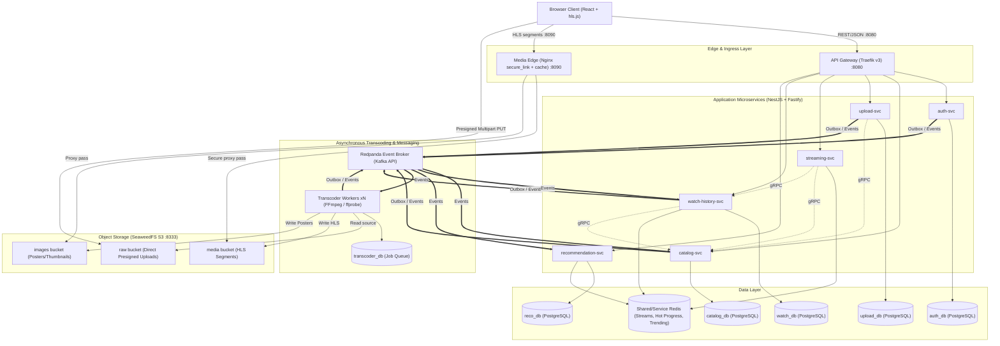

# StreamLite

A production-grade Netflix-style video streaming platform built as microservices using TypeScript, NestJS, and Docker.

---

## Overview

StreamLite provides an end-to-end video streaming pipeline designed to run locally with zero-cost open-source infrastructure:
- **Accounts & Auth**: Argon2id password hashing, Ed25519 EdDSA JWTs with JWKS rotation, sliding-window refresh tokens with reuse detection, and multi-profile support.
- **Media Pipeline**: Resumable multipart upload directly to S3-compatible storage (SeaweedFS), FFmpeg adaptive bitrate (ABR) ladder transcoding (480p / 720p / 1080p fMP4 HLS), and an atomic playlist publish flow.
- **Edge Streaming**: Expiring signed media URLs verified by an Nginx reverse proxy (`secure_link`) with local segment caching.
- **Watch History & Library**: Resume-where-you-left-off with write-behind buffering via Redis and PostgreSQL.
- **Recommendation Engine**: Event-driven trending feeds and item-item similarity recommendations computed using Node.js `worker_threads`.

---

## Architecture

---

## Tech Stack

- **Runtime**: Node.js LTS, TypeScript 5.x (strict)
- **Framework**: NestJS with Fastify adapter
- **Database & Cache**: PostgreSQL 16, Redis 7
- **Data Access & Migrations**: Kysely (type-safe SQL builder) + `node-pg-migrate`
- **Event Streaming**: Redpanda (Kafka-compatible API) via KafkaJS with transactional outbox & idempotent consumers
- **Object Storage**: SeaweedFS (S3-compatible, zero-cost local Docker storage)
- **Gateway & CDN Edge**: Traefik v3, Nginx (`secure_link` + proxy caching)
- **Transcoding**: FFmpeg & ffprobe
- **Tooling**: npm workspaces, Docker Compose v2
