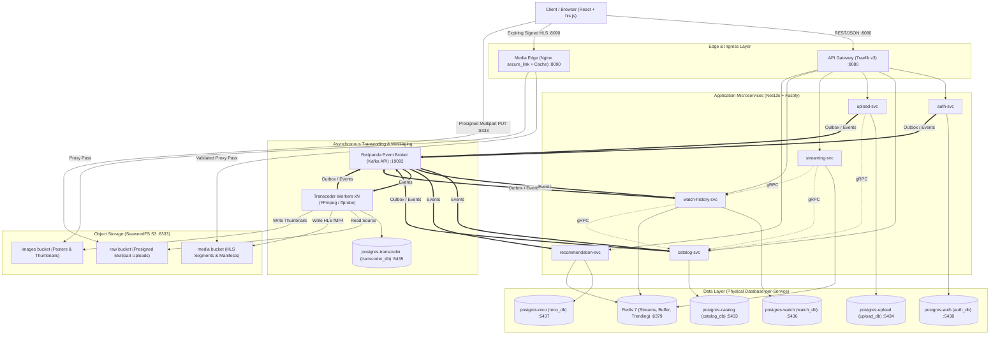

# StreamLite

[](https://nodejs.org/)
[](https://www.typescriptlang.org/)
[](https://nestjs.com/)
[](https://grpc.io/)
[](https://www.postgresql.org/)
[](https://redpanda.com/)
[](https://redis.io/)
[](https://www.docker.com/)
[](LICENSE)

A production-grade, Netflix-style video streaming platform engineered as distributed microservices in **TypeScript**, **NestJS (Fastify)**, and **Docker**. StreamLite provides an end-to-end media pipeline—from direct-to-storage resumable multipart ingestion, asynchronous FFmpeg adaptive bitrate transcoding, and expiring signed playback, to write-behind watch history and event-driven recommendations.

Designed from first principles to run completely locally on zero-cost, containerized infrastructure with strict reliability, security, and observability baselines.

---

## Table of Contents

- [System Architecture](#system-architecture)
- [Key Features & Capabilities](#key-features--capabilities)
- [Core Engineering Decisions](#core-engineering-decisions)
- [Repository Layout](#repository-layout)
- [Infrastructure & Port Reference](#infrastructure--port-reference)
- [Getting Started](#getting-started)
- [Development Workflows](#development-workflows)
- [Security & Reliability Guarantees](#security--reliability-guarantees)
- [License](#license)

---

## System Architecture

StreamLite follows a **Database-per-Service** architecture. Edge ingress and media delivery are decoupled from application logic: public client traffic enters through the Traefik API Gateway, video segments are served directly by an Nginx caching proxy with cryptographic signature verification, and binary video uploads stream directly to S3-compatible object storage (SeaweedFS) via presigned URLs.



---

## Key Features & Capabilities

### Identity, Sessions & Access Control (`auth-svc`)

- **Password Security:** Memory-hard Argon2id password hashing with explicit concurrency semaphores to protect libuv threadpool performance.
- **Two-Tier EdDSA JWTs:**
  - _Account-scoped JWTs:_ Issued upon authentication for user profile, billing, and session management.
  - _Profile-scoped JWTs:_ Injects active `profileId` and parental `ageLimit` claims, mandatory for media playback and recommendations.
- **Decentralized Verification:** Services verify JWTs locally using an automated JSON Web Key Set (JWKS) cache without calling `auth-svc` on every request.
- **Rotating Refresh Tokens:** Sliding-window refresh cookies stored as SHA-256 binary hashes (`bytea`). Includes automatic token-family reuse detection (stealing an old token immediately revokes the entire family).
- **Hardened User Model:** Multi-profile isolation (up to 5 profiles per account, kids flag), case-insensitive email uniqueness via PostgreSQL `citext`, and anti-enumeration generic responses.

### Media Ingestion & Direct-to-Storage Upload (`upload-svc`)

- **Direct S3 Presigning:** High-throughput browser-to-storage uploads via presigned multipart S3 URLs. Server memory and event loop are never blocked by heavy video streams.
- **Resumable Transfers:** S3 `ListParts` verification enables pausing and resuming uploads across browser reloads.
- **Integrity Validation:** Client-side ETag header exposure for multipart chunk verification; asynchronous media format and codec validation via `ffprobe`.

### Adaptive Transcoding Pipeline (`transcoder`)

- **Adaptive Bitrate (ABR) Ladder:** Automatically transcodes video into 480p, 720p, and 1080p fragmented MP4 (fMP4) HLS streams with standard 6-second segment durations and an atomic master playlist (`master.m3u8`).
- **PostgreSQL Lease-Based Job Queue:** Avoids Kafka consumer group timeouts during long transcode operations by utilizing PostgreSQL `FOR UPDATE SKIP LOCKED` with timed worker leases and crash recovery.
- **Asset Generation:** Extracts seek-preview sprite sheets and poster frames during video processing.

### Edge Delivery & Streaming (`streaming-svc` + `media-edge`)

- **Expiring Signed URLs:** Nginx `secure_link` validates MD5 client IP and expiration tokens before proxying media segments. Public, unsigned video URLs do not exist.
- **Distributed Cache:** Shared local disk segment caching on the Nginx media edge reduces S3 storage I/O under concurrent viewership.
- **Concurrent Stream Management:** Redis-backed heartbeat sessions enforce a limit of 2 concurrent streams per account.

### Library & Watch Progress (`watch-history-svc`)

- **Write-Behind Caching:** High-frequency playback heartbeats buffer directly to Redis and asynchronously flush in timed batches to PostgreSQL, preventing database write exhaustion.
- **Continue Watching:** Automatically calculates resume offsets, detects completion thresholds, and determines next-episode transitions for episodic series.
- **Personal Watchlists:** Manages profile-specific favorites ("My List") and ratings (thumbs up/down).

### Recommendation Engine (`recommendation-svc`)

- **Event-Driven Aggregation:** Consumes watch events from Redpanda to generate time-decayed trending scores and "Top 10" rankings.
- **Non-Blocking Similarity Computations:** Offloads sparse item-item cosine similarity calculations to dedicated Node.js `worker_threads`, keeping the main event loop completely responsive.
- **Personalized Rails:** Tailored home screen rows incorporating user history, genre affinities, and cold-start fallbacks.

---

## Core Engineering Decisions

| Requirement            | Architectural Choice            | Justification                                                                                                                                                                                                                                                     |
| :--------------------- | :------------------------------ | :---------------------------------------------------------------------------------------------------------------------------------------------------------------------------------------------------------------------------------------------------------------- |
| **Data Isolation**     | Physical Database-per-Service   | Each microservice owns an independent PostgreSQL container on its own port. Cross-database queries and joins are physically impossible, ensuring true microservice boundary enforcement.                                                                          |
| **Data Access Layer**  | Kysely + `node-pg-migrate`      | Replaces heavy ORMs (Prisma, TypeORM). Migrations are written in plain, forward-only SQL. Types are derived directly from the live PostgreSQL database via `kysely-codegen`, delivering complete compile-time type safety with zero runtime abstraction overhead. |
| **Internal Transport** | gRPC + Protobuf over HTTP/2     | Replaces internal REST/JSON with compact binary serialization (7–10x faster, up to 80% smaller payloads) and multiplexed connections across microservices.                                                                                                        |
| **Event Reliability**  | Transactional Outbox + Redpanda | Prevents dual-write data inconsistencies. Domain state mutations and outbox records commit within the same local database transaction. Dedicated relay workers poll using `FOR UPDATE SKIP LOCKED`, and consumers enforce idempotency via `processed_events`.     |
| **Object Storage**     | SeaweedFS (Local S3 API)        | Provides full AWS S3 API compatibility at $0 cost on local disk. Dual S3 clients handle internal container networking (`http://s3:8333`) and host browser presigning (`http://localhost:8333`).                                                                   |
| **Structured Logging** | Pino + `AsyncLocalStorage`      | Zero-overhead JSON logging. Request IDs and W3C traceparents automatically propagate across async boundaries without passing context objects through function signatures.                                                                                         |
| **Error Handling**     | RFC 7807 Problem Details        | Standardized error payload contract (`application/problem+json`) enforced monorepo-wide through shared HTTP exception filters.                                                                                                                                    |

---

## Repository Layout

StreamLite is organized as an npm monorepo with strict TypeScript project references:

```text
StreamLite/
├── packages/                         # Reusable core libraries (internal workspaces)
│   ├── contracts/                    # Zod schemas, DTOs, pagination, enums, problem details
│   ├── logger/                       # Pino logging with AsyncLocalStorage & PII redaction
│   ├── http/                         # RFC 7807 problem details exception filters & decorators
│   ├── blob/                         # Dual-client S3 storage abstraction (SeaweedFS)
│   ├── events/                       # KafkaJS wrapper, envelope serialization & DLQ routing
│   ├── outbox/                       # Transactional outbox relay & idempotent consumer
│   └── proto-gen/                    # Buf-generated TypeScript types & gRPC service interfaces
│
├── services/                         # Microservices (NestJS + Fastify)
│   ├── auth/                         # Identity, sessions, JWKS, token rotation & Kysely store
│   ├── catalog/                      # Titles, seasons, episodes, search & gRPC server (planned)
│   ├── upload/                       # Resumable S3 multipart upload lifecycle (planned)
│   ├── transcoder/                   # FFmpeg ABR HLS worker & lease job queue (planned)
│   ├── streaming/                    # Playback authorization & signed link generator (planned)
│   ├── watch-history/                # Watch progress, Redis write-behind & library (planned)
│   └── recommendation/               # Trending scores & worker_threads similarity (planned)
│
├── proto/                            # Protocol Buffer contract definitions
│   ├── catalog/v1/catalog.proto      # Catalog gRPC service specifications
│   ├── watch/v1/watch.proto          # Watch history gRPC service specifications
│   └── buf.yaml                      # Buf CLI configuration
│
├── deploy/                           # Deployment & local infrastructure
│   ├── docker-compose.yml            # Multi-container orchestration (Core & Observability profiles)
│   ├── postgres/                     # Database initialization scripts
│   └── seaweedfs/                    # S3 bucket configuration & CORS policies
│
├── web/                              # Client application (React + Vite + hls.js)
├── Makefile                          # Unified developer command automation
├── tsconfig.base.json                # Strict TypeScript root compiler configuration
└── package.json                      # Workspaces configuration and root scripts
```

---

## Infrastructure & Port Reference

All infrastructure runs via `deploy/docker-compose.yml` across two isolated Docker bridge networks (`streamlite-edge` and `streamlite-backend`).

| Service                  | Container Name                   | Host Port | Internal Port | Protocol   | Purpose                                                    |
| :----------------------- | :------------------------------- | :-------- | :------------ | :--------- | :--------------------------------------------------------- |
| **API Gateway**          | `streamlite-gateway`             | `8080`    | `80`          | HTTP/REST  | Traefik v3 edge routing, rate limiting & CORS              |
| **Media Edge**           | `streamlite-media-edge`          | `8090`    | `80`          | HTTP/HLS   | Nginx reverse proxy with `secure_link` & segment cache     |
| **S3 Storage**           | `streamlite-s3`                  | `8333`    | `8333`        | HTTP/S3    | SeaweedFS S3 storage API (`raw`, `media`, `images`)        |
| **S3 Filer**             | `streamlite-s3`                  | `8888`    | `8888`        | HTTP       | SeaweedFS internal file manager                            |
| **Kafka Broker**         | `streamlite-redpanda`            | `19092`   | `9092`        | Kafka Wire | Redpanda event broker (Kafka API v2 compatible)            |
| **Kafka Admin**          | `streamlite-redpanda`            | `9644`    | `9644`        | HTTP       | Redpanda admin and healthcheck endpoint                    |
| **Redis**                | `streamlite-redis`               | `6379`    | `6379`        | RESP       | Session limits, write-behind buffering & trending feeds    |
| **Mailpit Web**          | `streamlite-mailpit`             | `8025`    | `8025`        | HTTP       | Local SMTP inbox interface for email verification          |
| **Mailpit SMTP**         | `streamlite-mailpit`             | `1025`    | `1025`        | SMTP       | Local mail transfer protocol catcher                       |
| **Postgres: Auth**       | `streamlite-postgres-auth`       | `5438`    | `5432`        | PostgreSQL | Identity, credentials, profiles, sessions (`auth_db`)      |
| **Postgres: Catalog**    | `streamlite-postgres-catalog`    | `5433`    | `5432`        | PostgreSQL | Titles, seasons, episodes, search indexes (`catalog_db`)   |
| **Postgres: Upload**     | `streamlite-postgres-upload`     | `5434`    | `5432`        | PostgreSQL | Multipart upload sessions & metadata (`upload_db`)         |
| **Postgres: Transcoder** | `streamlite-postgres-transcoder` | `5435`    | `5432`        | PostgreSQL | Transcoding job queue, leases & metrics (`transcoder_db`)  |
| **Postgres: Watch**      | `streamlite-postgres-watch`      | `5436`    | `5432`        | PostgreSQL | Progress offsets, watch history, My List (`watch_db`)      |
| **Postgres: Reco**       | `streamlite-postgres-reco`       | `5437`    | `5432`        | PostgreSQL | Similarity scores & cached recommendation rows (`reco_db`) |

---

## Getting Started

### Prerequisites

- **Node.js**: `v22.x LTS` or higher
- **npm**: `v10.x` or higher
- **Docker**: Docker Engine `v24+` and Docker Compose `v2+`
- **Make**: Standard build automation utility

### Installation & Initialization

1. **Clone the repository:**

   ```bash
   git clone https://github.com/mahin273/StreamLite.git
   cd StreamLite
   ```

2. **Install monorepo dependencies:**

   ```bash
   npm install
   ```

3. **Start the local infrastructure:**

   ```bash
   make up
   ```

   _This starts all 6 PostgreSQL instances, Redis 7, Redpanda, SeaweedFS, and Mailpit with container health checks._

4. **Verify container health:**

   ```bash
   make ps
   ```

   All containers should display status `Up (healthy)`.

5. **Run database migrations:**

   ```bash
   npm run migrate:up --workspace=@streamlite/auth-service
   ```

6. **Execute automated test suites:**
   ```bash
   make test
   ```

---

## Development Workflows

### Common Make Commands

```bash
make up         # Boot all core infrastructure containers in the background
make down       # Gracefully stop all infrastructure containers
make down-v     # Stop containers and purge all local storage volumes
make ps         # Inspect running containers and their health statuses
make logs       # Stream real-time logs from infrastructure containers
make test       # Run tests across all packages and services
make lint       # Run ESLint across all workspaces
make typecheck  # Run TypeScript typechecks across the monorepo
make clean      # Clean compilation artifacts and build caches
```

### TypeScript Compilation & Type Generation

- **Build all workspaces:**
  ```bash
  npm run build
  ```
- **Compile Protocol Buffers:**
  ```bash
  npm run proto:generate
  ```
- **Generate Kysely Database Types from Live Schema:**
  ```bash
  npm run codegen:kysely --workspace=@streamlite/auth-service
  ```

---

## Security & Reliability Guarantees

- **Zero Unparameterized Queries:** All SQL is executed strictly via Kysely's type-safe parameterized builder. SQL injection via raw string interpolation is prohibited.
- **At-Least-Once Delivery & Exactly-Once Processing:** The Transactional Outbox pattern guarantees no event is lost between database commits and broker publishing. Idempotent consumers verify incoming message IDs against an atomic `processed_events` table within the domain transaction.
- **Constant-Time Verification:** Argon2id password verification and cryptographic token lookups execute in constant time to prevent timing attacks.
- **Safe Integer Serialization:** PostgreSQL `int8` (OID 20) values are converted by a configured type parser to native JavaScript numbers, preventing integer parsing bugs while remaining within safe numeric bounds ($< 2^{53} - 1$).
- **Fail-Fast Configuration:** Every package and service validates its environment configuration at boot time using strict Zod schemas. Missing or malformed variables terminate the process immediately.

---

## License

This project is licensed under the terms of the [MIT License](LICENSE).
